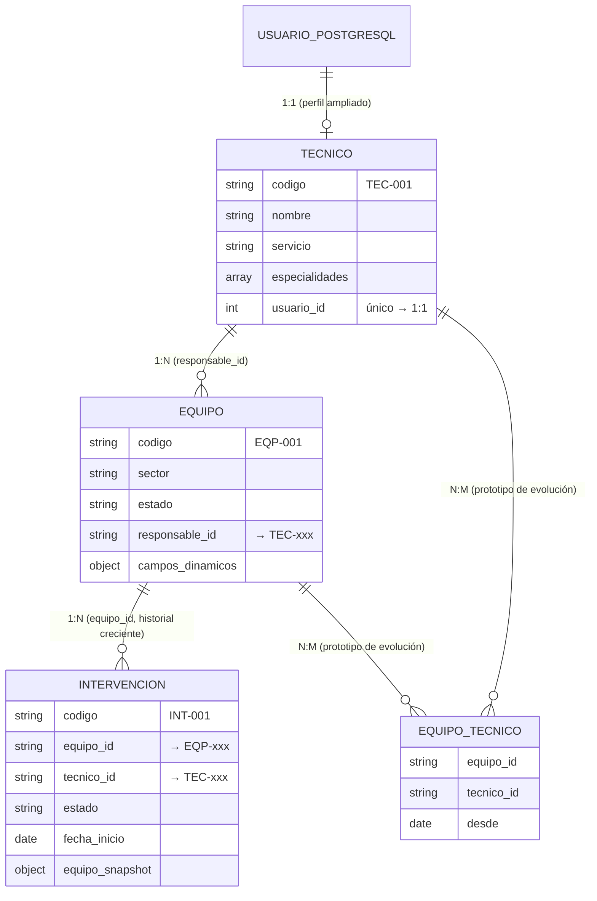

# Modelo documental v1 — SITBIO (E02)

Base: `sitbio_lab_nosql` · 3 colecciones · dataset `SITBIO_UE_V1` (adaptación del caso de la guía).

## Diagrama de entidades y cardinalidades

### Tipos de relación del modelo

| Relación | Colecciones | Cardinalidad | Soporte |
|---|---|---|---|
| Usuario ↔ Técnico | `usuarios` (PostgreSQL, sistema SITBIO) ↔ `tecnicos` | **1:1** | `tecnicos.usuario_id` único: un técnico nace de un usuario del sistema y no puede repetirse |
| Técnico → Equipos | `tecnicos` ↔ `equipos` | **1:N** | `equipos.responsable_id`: un técnico es responsable de varios equipos; un equipo tiene un solo responsable de referencia |
| Equipo → Intervenciones | `equipos` ↔ `intervenciones` | **1:N** | `intervenciones.equipo_id`: historial que crece sin límite; por eso va en colección separada (decisión D-01) |
| Equipo ↔ Técnicos | `equipos` ↔ `tecnicos` | **N:M (prototipo)** | Un equipo es atendido por muchos técnicos y un técnico atiende muchos equipos. Hoy se resuelve con el campo `intervenciones.tecnico_id`; si la consulta "quién ha atendido este equipo y cuántas veces" se vuelve frecuente, la evolución es una colección pivote `equipo_tecnico { equipo_id, tecnico_id, desde, hasta }` con índice compuesto `{ equipo_id: 1, tecnico_id: 1 }` |

## Forma de los documentos (resumen)

- **tecnicos** (10): identidad, `servicio` (sector clínico), arreglo `especialidades`, referencia `usuario_id`.
- **equipos** (15): identidad, `sector`, `estado`, `ubicacion`, referencia `responsable_id` y
  `campos_dinamicos` (atributos configurables por institución: `clasificacion_riesgo` —atributo propio de la adaptación—, `resolucion_sanitaria`).
- **intervenciones** (30): identidad, referencias `equipo_id`/`tecnico_id`, `tipo`, fechas UTC,
  arreglo `repuestos`, `horas_invertidas`, `notas` y **`equipo_snapshot`**
  (`ubicacion`, `estado` y `capturado_en` del equipo **al momento de la intervención** — ver decisión D-03).

El detalle campo por campo está en `../diccionario.md`; el porqué de cada estructura, en `../decisiones.md`.
